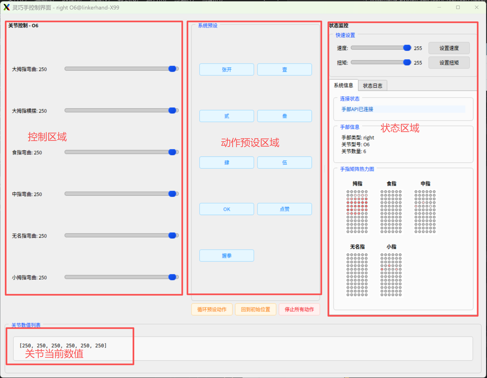

# LinkerHand-Python-SDK

## 概述 Linker Hand [灵心巧手(北京)科技有限公司](https://linkerbot.cn/index)
专注于人工智能和机器人解决方案，帮助开发者、企业、科研机构快速实现真实场景落地

[中文](README_CN.md)  |  [English](README.md)

## 注意
- 请确保灵巧手未开启其他控制，如linker_hand_sdk_ros、动捕手套控制和其他控制灵巧手的topic。以免冲突。
- 请将固定灵巧手，以免灵巧手在运动时跌落。
- 请确保灵巧手电源与USB转CAN连接正确。

| Name | Version | Link |
| --- | --- | --- |
| Python SDK |     | [](https://github.com/linker-bot/linkerhand-python-sdk) |
| ROS SDK |     | [](https://github.com/linker-bot/linkerhand-ros-sdk) |
| ROS2 SDK |      | [](https://github.com/linker-bot/linkerhand-ros2-sdk) |

## Installation
&ensp;&ensp;您可以在安装requirements.txt后的情况下运行示例。仅支持 Python3。
- download

```bash
$ git clone https://github.com/linker-bot/linkerhand-python-sdk.git
```

- install

```bash
$ cd linkerhand-python-sdk/
# win下需要安装python-can-candle用于适配透明CAN设备candle协议
$ pip install python-can
$ pip install python-can-candle
$ pip3 install -r requirements.txt
```

- 快速使用示例 by CAN
编辑config/setting.yaml配置文件，按照配置文件内注释说明进行参数修改,配置CAN: "can0"(根据实际硬件情况来确定，一般第一个为can0)，配置MODBUS:"None"
```bash
# Open the CAN port
$ sudo /usr/sbin/ip link set can0 up type can bitrate 1000000 # USB-to-CAN device blue light stays solid. This step can be skipped on Ubuntu systems after modifying setting.ymal as required.
$ cd examples/gui_control
$ sudo chmod a+x gui_control.py
$ python3 gui_control.py
```



## RS485 协议使用 当前支持O6/L6/L7/L10，其他型号灵巧手请参考[官网MODBUS RS485协议文档](https://document.linkeros.cn/developer/90) 注：如不确定协议类型，请咨询技术支持。

编辑config/setting.yaml配置文件，按照配置文件内注释说明进行参数修改,将MODBUS:"/dev/ttyUSB0"，配置文件中"modbus"参数为"/dev/ttyUSB0"。USB-RS485转换器在Ubuntu上一般显示为/dev/ttyUSB* or /dev/ttyACM*
modbus: "None" or "/dev/ttyUSB0"
```bash
# 确保requirements.txt安装依赖
# 安装系统级相关驱动
$ pip install minimalmodbus --break-system-packages
$ pip install pyserial --break-system-packages
$ pip install pymodbus --break-system-packages
# 查看USB-RS485端口号
$ ls /dev
# 可以看到类似ttyUSB0端口后给端口执行权限
$ sudo chmod 777 /dev/ttyUSB0
# GUI控制示例
$ python3 example/gui_control/gui_control.py

```


## 相关文档
[Linker Hand API for Python Document](doc/API-Reference.md)

## 更新说明

- > ### release_3.0.1
 - 1、支持O6/L6/L10 RS485通讯 pymodbus模式

- > ### release_2.2.4
 - 1、新增支持G20工业版灵巧手
 - 2、重绘GUI


- > ### release_2.1.9
 - 1、新增支持O6灵巧手

- > ### release_2.1.8
 - 1、修复偶发撞帧问题

- > ### 2.1.4
  - 1、新增支持L21
  - 2、新增支持矩阵式压力传感器
  - 3、支持L10 Mujoco仿真


- > ### 1.3.6
  - 支持LinkerHand L7/L20/L25版本灵巧手

- > ### 1.1.2
  - 支持LinkerHand L10版本灵巧手
  - 增加GUI控制L10灵巧手
  - 增加GUI显示L10灵巧手压感图形模式数据
  - 增加部分示例源码
  
- position与手指关节对照表

  O6:  ["大拇指弯曲", "大拇指横摆","食指弯曲", "中指弯曲", "无名指弯曲","小拇指弯曲"]

  L6:  ["大拇指弯曲", "大拇指横摆","食指弯曲", "中指弯曲", "无名指弯曲","小拇指弯曲"]

  L7:  ["大拇指弯曲", "大拇指横摆","食指弯曲", "中指弯曲", "无名指弯曲","小拇指弯曲","拇指旋转"]

  L10: ["拇指根部", "拇指侧摆","食指根部", "中指根部", "无名指根部","小指根部","食指侧摆","无名指侧摆","小指侧摆","拇指旋转"]

  L20: ["拇指根部", "食指根部", "中指根部", "无名指根部","小指根部","拇指侧摆","食指侧摆","中指侧摆","无名指侧摆","小指侧摆","拇指横摆","预留","预留","预留","预留","拇指尖部","食指末端","中指末端","无名指末端","小指末端"]

  G20(工业版): ["拇指根部", "食指根部", "中指根部", "无名指根部","小指根部","拇指侧摆","食指侧摆","中指侧摆","无名指侧摆","小指侧摆","拇指横摆","预留","预留","预留","预留","拇指尖部","食指末端","中指末端","无名指末端","小指末端"]

  L21: ["大拇指根部","食指根部","中指根部","无名指根部","小拇指根部","大拇指侧摆","食指侧摆","中指侧摆","无名指侧摆","小拇指侧摆","大拇指横滚","预留","预留","预留","预留","大拇指中部","预留","预留","预留","预留","大拇指指尖","食指指尖","中指指尖","无名指指尖","小拇指指尖"]

  L25: ["大拇指根部", "食指根部", "中指根部","无名指根部","小拇指根部","大拇指侧摆","食指侧摆","中指侧摆","无名指侧摆","小拇指侧摆","大拇指横滚","预留","预留","预留","预留","大拇指中部","食指中部","中指中部","无名指中部","小拇指中部","大拇指指尖","食指指尖","中指指尖","无名指指尖","小拇指指尖"]

## [L10_Example](example/L10)

&ensp;&ensp; __在运行之前, 请将 [setting.yaml](LinkerHand/config/setting.yaml) 的配置信息修改为您实际控制的灵巧手配置信息.__

- #### [0000-gui_control](example/gui_control/gui_control.py)
开启后会弹出UI界面。通过滑动条可控制相应LinkerHand灵巧手关节运动

- 增加或修改动作示例。在[constants.py](example/gui_control/config/constants.py)文件中可增加或修改动作。
```python
# 例如增加L6的动作序列
"L6": HandConfig(
        joint_names_en=["thumb_cmc_pitch", "thumb_cmc_yaw", "index_mcp_pitch", "middle_mcp_pitch", "pinky_mcp_pitch", "ring_mcp_pitch"],
        joint_names=["大拇指弯曲", "大拇指横摆", "食指弯曲", "中指弯曲", "无名指弯曲", "小拇指弯曲"],
        init_pos=[250] * 6,
        preset_actions={
            "张开": [250, 250, 250, 250, 250, 250],
            "壹": [0, 31, 255, 0, 0, 0],
            "贰": [0, 31, 255, 255, 0, 0],
            "叁": [0, 30, 255, 255, 255, 0], 
            "肆": [0, 30, 255, 255, 255, 255],
            "伍": [250, 250, 250, 250, 250, 250],
            "OK": [54, 41, 164, 250, 250, 250],
            "点赞": [255, 31, 0, 0, 0, 0],
            "握拳": [49, 61, 0, 0, 0, 0],
            # 增加自定义动作......
        }
    )
```


- #### [0001-linker_hand_fast](example/L10/gesture/linker_hand_fast.py)
- #### [0002-linker_hand_finger_bend](example/L10/gesture/linker_hand_finger_bend.py)
- #### [0003-linker_hand_fist](example/L10/gesture/linker_hand_fist.py)
- #### [0004-linker_hand_open_palm](example/L10/gesture/linker_hand_open_palm.py)
- #### [0005-linker_hand_opposition](example/L10/gesture/linker_hand_opposition.py)
- #### [0006-linker_hand_sway](example/L10/gesture/linker_hand_sway.py)

- #### [0007-linker_hand_get_force](example/L10/get_status/get_force.py) #python3 get_force.py --hand_joint L10 --hand_type right
- #### [0008-linker_hand_get_speed](example/L10/get_status/get_set_speed.py) #python3 get_set_speed.py --hand_joint L10 --hand_type right --speed 100 123 211 121 222   注:L7 speed参数为7个，其他为5个
- #### [0009-linker_hand_get_state](example/L10/get_status/get_set_state.py) # python3 get_set_state.py --hand_joint L10 --hand_type right --position 100 123 211 121 222 255 255 255 255 255  position参数个数请参照position与手指关节对照表

- #### [0010-linker_hand_dynamic_grasping](example/L10/grab/dynamic_grasping.py)


## 摄像头手势模仿

用普通摄像头识别手势并实时模仿到 O6/L6 灵巧手，不需要训练模型，也不需要动捕手套。

- 命令行：[example/camera_mimic.py](example/camera_mimic.py)
- 图形界面：[example/camera_mimic_gui.py](example/camera_mimic_gui.py)

### 快速开始

```bash
# 1) 只看识别效果，不碰硬件
python3 example/camera_mimic.py --dry-run

# 2) 整手标定：做两个姿态，分别对应全 255 和全 0
python3 example/camera_mimic.py --calibrate

# 3) 用测试照片回归映射结果（不开摄像头也能跑）
python3 example/camera_mimic.py --images resource/hand_test

# 4) 接上灵巧手正式运行（Ubuntu 把 CAN 换成 can0）
python3 example/camera_mimic.py --hand_type right --hand_joint O6 --can PCAN_USBBUS1

# 图形界面：摄像头画面 + 实时关节值 + 参数调节 + 录制回放 + 整手标定
python3 example/camera_mimic_gui.py

# 5) 不开摄像头，直接回放录制或执行命名手势（加 --dry-run 只打印不下发）
python3 example/camera_mimic.py --list
python3 example/camera_mimic.py --play 录制的名字 --speed 1.5 --loop
python3 example/camera_mimic.py --gesture 手势的名字
```

命令行窗口快捷键：`r` 开始/结束录制，`p` 回放最近一次录制，`g` 保存当前静态手势，`空格` 暂停/恢复下发，`q`/`ESC` 退出（平滑回到张开位）。

### 整手标定

换人、换相机、换光照都要重标一次，两条命令的事：

```bash
python3 example/camera_mimic.py --calibrate
```

窗口里按提示做两个姿态：

1. **完全张开**：五指张到最大、拇指尽量外展，按 `a`。这个姿态映射成 `[255,255,255,255,255,255]`。
2. **攥拳压拇指**：攥拳并把拇指压在中指第一指节上，按 `b`。这个姿态映射成 `[0,0,0,0,0,0]`。

程序会打印每个关节在两个姿态下的读数，写进 `resource/calibration.json`，之后每次启动自动生效。GUI 里是「记录张开」「记录握拳」两个按钮，标完立即生效，不用重启；旁边有「忽略标定文件，用默认阈值」的开关。

标定是**逐关节**的：六个量各自记自己的两个端点，所以每个人手的量程差异会被吸收掉。这也是拇指弯曲能走满行程的原因——人拇指的屈曲角变化范围比默认常量窄得多。

### 手势到关节的映射

关节顺序 `[拇指弯曲, 拇指横摆, 食指, 中指, 无名指, 小指]`，取值 0（握拳端）~255（张开端）。

| 目标关节 | 视觉量 | 用到的关键点 | 标定键 |
| --- | --- | --- | --- |
| 食指/中指/无名指/小指 | MCP+PIP+DIP 三个屈曲角之和 | 0 与该指四个点 | `index` `middle` `ring` `pinky` |
| 拇指横摆 | 近节(1→2)在掌平面内相对长轴的摆角 | 0 1 2 5 9 17 | `thumb_yaw` |
| 拇指弯曲 | MCP(1-2-3)+IP(2-3-4) 屈曲角之和 | 1 2 3 4 | `thumb_pitch` |

掌平面由手腕 0、食指根 5、中指根 9、小指根 17 建立。拇指两个量都不使用其他手指的关键点，所以食指弯曲不会带动拇指；拇指弯曲与横摆也互不影响。

实时处理：EMA 平滑（`SMOOTH_ALPHA`）→ 死区（变化小于 `DEADBAND` 不发 CAN）→ 无人手时保持上一姿态 → 退出时 12 步平滑回张开位。

### 调参

没有 `calibration.json` 时用文件顶部的 `DEFAULT_CALIBRATION`（2026-11-04 用真手标定的出厂量程）；再标定一次就以你自己的为准。

| 常量 | 默认 | 什么时候改 |
| --- | --- | --- |
| `DEFAULT_CALIBRATION["thumb_pitch"]` | `(21.39, 51.07)` | 拇指 MCP+IP 屈曲角之和：张开端 / 握拳端 |
| `DEFAULT_CALIBRATION["thumb_yaw"]` | `(34.25, 14.79)` | 拇指近节摆角：张开端 / 收拢端 |
| `DEFAULT_CALIBRATION["index"]` | `(14.24, 199.27)` | 食指 MCP+PIP+DIP 屈曲角之和 |
| `DEFAULT_CALIBRATION["middle"]` | `(13.81, 258.17)` | 中指同上 |
| `DEFAULT_CALIBRATION["ring"]` | `(10.77, 241.64)` | 无名指同上 |
| `DEFAULT_CALIBRATION["pinky"]` | `(15.93, 227.59)` | 小指同上 |
| `POSE_OPEN` / `POSE_CLOSED` | `255 / 0` | 两个标定姿态映射到的关节值，六个关节共用 |
| `SEND_SPEED` | `250` | 动作太猛就降到 150~200 |
| `SMOOTH_ALPHA` | `0.5` | 想更跟手调到 0.7，想更稳调到 0.3 |

标定文件按 `hand_joint` + `hand_type` 双条件匹配，型号或左右手对不上会打印原因并退回上面的默认值，不会拿一只手的标定去驱动另一只手。

标定文件按 `hand_joint` + `hand_type` 双条件匹配，型号或左右手对不上会打印原因并退回默认阈值，不会拿一只手的标定去驱动另一只手。

### 手势录制与静态手势

两种存法，都存在 `resource/` 下，都是可读的 JSON。

**序列录制**（连续动作）：按 `r` 开始、再按 `r` 结束，GUI 用「开始录制/停止录制」按钮。只记录检测到手的那几帧，存的是实际下发的平滑后姿态，所以回放就是当时手做的动作。

```json
{"hand_joint": "O6", "created": "2026-11-04T16:12:38",
 "frames": [[0, [250,250,250,250,250,250]], [38, [241,250,120,60,30,0]]]}
```

`frames` 每项是 `[相对毫秒, 6 个关节值]`，回放按时间戳推进，`--speed` 倍速、`--loop` 循环；GUI 里倍速和循环是控件。

**静态手势拍照**（单个姿态）：按 `g` 或点「拍照保存当前手势」，写出一份姿态 JSON 和一张同名参考照片（照片是当前摄像头帧，含骨架叠加）。之后按名字执行：从手当前实际位置平滑过渡过去（用 `get_state()` 读回起点），约 0.6 秒到位。

```
resource/recordings/<名字>.json
resource/gestures/<名字>.json + <名字>.jpg
```

安全约束：文件里的 `hand_joint` 和当前型号不一致会直接拒绝并提示，避免把 6 个值发给 10 关节的手。回放或执行手势时不需要人站在摄像头前，`--play`/`--gesture` 连摄像头都不开。

### 开发步骤

按下面的顺序做，可以在没有硬件的机器上把风险提前暴露出来。

1. **先探测环境和目标手契约**。`import mediapipe` 看版本：1.x 已移除 `mp.solutions`，只能用 `mediapipe.tasks.python.vision.HandLandmarker`。关节顺序、数组长度、速度参数以驱动为准（`LinkerHand/core/can/linker_hand_o6_can.py` 的 `get_finger_order()` 和 `set_speed()` 要求正好 6 个），不要按 GUI 里的英文注释猜——那里的 `joint_names_en` 把无名指和小指写反了。
2. **落地模型**。`hand_landmarker.task`（约 7.8 MB）放到 `resource/models/`，缺失时脚本自动下载。项目路径含中文时 `BaseOptions(model_asset_path=...)` 会抛 `Unable to open file`，必须读成字节用 `model_asset_buffer`；读测试照片同理，`cv2.imread` 打不开中文路径，要 `np.fromfile` + `cv2.imdecode`。
3. **写映射**。先四指后拇指，每个量都写成「只依赖该关节自身关键点」的形式，从源头避免耦合。
4. **分层验证，由弱到强**。
   - 合成关键点：断言弯曲量单调、两端命中端点（无标定文件时对照官方预设值），并断言三条解耦不变性——只弯指尖→横摆不变；只摆拇指根→弯曲不变；只弯食指→拇指不变。夹具必须在关节处真的折角，只缩短末节等于没弯。
   - 真人照片回归：`--images resource/hand_test`，对照张开/握拳/点赞/OK 四个姿态。素材必须是真人照片，3D 渲染图会给出错误的关节角度基线。
   - 摄像头 dry-run：确认帧率（640×480 实测约 27 FPS）、镜像、无人手保持。
   - 硬件冒烟：固定灵巧手、清空手掌前方物品，先低速小幅确认顺序和方向。
5. **按实测反馈迭代**。本项目实际踩过的顺序：拇指跟着食指动（弃用拇指尖—食指尖距离）→ 两个拇指关节同步动（拆成摆角与屈曲角）→ 弯曲方向相反（弃用末节出平面角，改用关节屈曲角）→ 四指半弯跳到两端（弃用三点直线度，它在 120° 就饱和）→ 拇指弯不到底（只用 IP 角量程不够，改成 MCP+IP 之和）→ 手写常量对不上个人量程（改成整手标定：两个姿态逐关节记两端，映射到 255 和 0）。
6. **加图形界面**。`camera_mimic_gui.py` 复用同一套映射函数，摄像头推理与 CAN 通信放在 `QThread` 里，界面只收信号刷新，参数改动即时生效。
7. **加录制与静态手势**。回放器 `Player` 用 `done` 标志区分「这一拍没有新帧」和「整段播完」——早期版本用返回 `None` 同时表示两者，结果只发出了第一帧。GUI 侧停止录制时直接取帧快照落盘，不靠工作线程轮询状态跳变，否则快速连点会丢录制。跨线程的日志信号是排队的，自动化测试里断言日志前要多跑一轮事件循环。

### 测试素材

`resource/hand_test/` 是四张带水印的正版素材照片（palm / fist / thumbsup / ok），只用于本地回归映射，请勿再分发或用于商业演示。

### 常见故障

| 现象 | 原因 | 处理 |
| --- | --- | --- |
| `No module named 'mediapipe.solutions'` | mediapipe 1.x 移除旧 API | 改用 Tasks API |
| `Unable to open file at ...`（路径显示乱码） | 中文路径 | 模型用 `model_asset_buffer`，图片用 `np.fromfile + cv2.imdecode` |
| 连上手没反应，终端只打印红字 | `finger_move` 长度与型号不匹配 | O6/L6 必须正好 6 个值 |
| `ValueError: Speed list must have 6 elements` | 速度数组长度不对 | O6/L6 的 `set_speed` 要正好 6 个 |
| 拇指跟着食指一起动 | 拇指量里用了食指尖相关量 | 拇指只用 0/1/2/3/4/5/9/17 |
| 手指半弯时跳到全弯或全开 | 三点直线度提前饱和 | 用屈曲角之和（当前实现） |
| 拇指弯不到底、手指中段没层次 | 手写阈值和这个人的量程不符 | `--calibrate` 或 GUI 两个标定按钮 |
| 换人/换相机/换光照后动作怪 | 量程变了 | 重做一次整手标定 |
| 启动时打印「改用默认阈值」 | 标定文件的型号或左右手与当前不符 | 按当前 `--hand_joint`/`--hand_type` 重标 |
| 标定打印里某个关节「这个量没动」 | 两个姿态做得不够极端 | 张到最大、拇指确实压到中指第一指节再重标 |
| 回放只动一下就停了 | 录制文件本身只有几帧，或倍速过高 | `--list` 看文件，`--speed 1` 重放 |
| 回放/执行手势报型号不符 | 文件和当前 `--hand_joint` 不同 | 用同型号录的，或改成对应型号 |
| GUI 里下拉框找不到刚录的文件 | 列表是缓存的 | 点「刷新」 |
| stderr 出现 XNNPACK / NORM_RECT 警告 | MediaPipe 正常输出 | 忽略 |

### 已知限制

- 只支持 O6/L6（6 自由度）。L7/L10/L20/L25 关节更多，需要另写映射。
- 同一画面只跟随最先检测到的一只手，不做双手切换。
- 单目摄像头对「朝向镜头」方向的深度不可靠，手掌翻转、拇指前伸的幅度会被压缩，换人换相机后建议重新标定阈值。
- 关节方向、力位表现仍需在真实硬件上逐项确认；本仓库的开发与验证过程没有连接过灵巧手。

## API 说明文档
[Linker Hand API for Python Document](doc/API-Reference.md)


